# Data Analyst Automaton Design

This document specifies the formal design and implementation of the **Data Analyst** profile classification automaton in ResumeLens.

---

## 1. Overview and Problem Statement

ResumeLens processes candidate resumes and determines whether their technical qualifications satisfy formal qualification patterns for specific professional profiles.

The **Data Analyst** profile evaluates whether a candidate possesses competencies across four core areas of modern data analysis:
1. **Query Languages** (e.g., SQL, PostgreSQL, MySQL)
2. **Analysis Languages** (e.g., Python, R)
3. **Data Processing Libraries** (e.g., Pandas, NumPy)
4. **Data Visualization Tools** (e.g., Power BI, Tableau, Matplotlib)
5. **Spreadsheet Software** (Excel) — defined as an **optional** skill.

The automaton receives a sequence of canonical skill tokens (the output of FST normalization) and returns `True` if the sequence satisfies the profile requirements and `False` otherwise.

---

## 2. Design Rationale: Order Independence

### 2.1 The Issue with Rigid Sequential Order
In an earlier version, the automaton enforced a strict linear progression:
$$\text{QUERY\_LANGUAGE} \longrightarrow \text{SPREADSHEET (optional)} \longrightarrow \text{ANALYSIS\_LANGUAGE} \longrightarrow \text{DATA\_PROCESSING} \longrightarrow \text{VISUALIZATION}$$

Under this rigid ordering:
- `["SQL", "PYTHON", "PANDAS", "POWER_BI"]` was accepted.
- `["PYTHON", "SQL", "PANDAS", "POWER_BI"]` was **rejected**, even though the candidate has the exact same competencies.

### 2.2 Specification Analysis
A review of the course assignment and project architecture documents (`docs/PROJECT_CONTEXT.md` and `docs/architecture.md`) confirms:
- Candidates write skills on a resume in arbitrary order based on personal preference or formatting.
- Qualification assessment evaluates whether the candidate's set of skills satisfies the profile criteria, not the textual order in which the applicant wrote them.
- While the pipeline contains an optional sorter (`sort_for_profile`), making the DFA inherently order-independent ensures that classification correctness is self-contained, robust, and not artificially coupled to an external sorting stage.

### 2.3 The Formal Solution: Powerset State Construction
To achieve order independence within a strictly deterministic finite automaton, the state set represents the **powerset** of satisfied mandatory categories:
$$\mathcal{P}(\{\text{QUERY}, \text{ANALYSIS}, \text{PROCESSING}, \text{VISUALIZATION}\})$$

Because there are 4 mandatory categories, the automaton has exactly $2^4 = 16$ states:
- Each state records which subset of mandatory categories has been satisfied so far.
- Transitions advance the subset monotonically: reading a skill from category $C$ transitions from state $S$ to state $S \cup \{C\}$.
- Reading an already-satisfied category or the optional category (`EXCEL`) results in a self-loop: $S \cup \{C\} = S$.
- Reading a foreign token (not in $\Sigma$) has no valid transition and immediately halts recognition.
- Acceptance requires reaching the unique state representing all 4 mandatory categories: $\{\text{QUERY}, \text{ANALYSIS}, \text{PROCESSING}, \text{VISUALIZATION}\}$.

By the Myhill-Nerode theorem, this 16-state DFA is **minimal** and **deterministic**.

---

## 3. Formal 5-Tuple Definition

The Data Analyst automaton is formally defined as:
$$M = (Q, \Sigma, \delta, q_0, F)$$

### 3.1 Input Alphabet ($\Sigma$)
The alphabet consists of all 11 canonical skill tokens belonging to the Data Analyst profile:

$$\Sigma = \Sigma_{\text{QUERY}} \cup \Sigma_{\text{SPREADSHEET}} \cup \Sigma_{\text{ANALYSIS}} \cup \Sigma_{\text{PROCESSING}} \cup \Sigma_{\text{VISUALIZATION}}$$

| Category | Obligation | Canonical Skill Tokens |
|---|---|---|
| `QUERY_LANGUAGE` | **Mandatory** | `SQL`, `POSTGRESQL`, `MYSQL` |
| `SPREADSHEET` | *Optional* | `EXCEL` |
| `ANALYSIS_LANGUAGE` | **Mandatory** | `PYTHON`, `R` |
| `DATA_PROCESSING` | **Mandatory** | `PANDAS`, `NUMPY` |
| `VISUALIZATION` | **Mandatory** | `POWER_BI`, `TABLEAU`, `MATPLOTLIB` |

Total symbols: $|\Sigma| = 11$.

### 3.2 State Set ($Q$)
$Q$ contains 16 states organized hierarchically by the number of satisfied mandatory categories (Rank 0 to 4):

| State Name | Rank | Satisfied Categories ($S$) | Description |
|---|---|---|---|
| `q_empty` | 0 | $\emptyset$ | Initial state; no mandatory categories seen yet. |
| `q_query` | 1 | $\{\text{QUERY}\}$ | Only Query Language satisfied. |
| `q_analysis` | 1 | $\{\text{ANALYSIS}\}$ | Only Analysis Language satisfied. |
| `q_processing` | 1 | $\{\text{PROCESSING}\}$ | Only Data Processing satisfied. |
| `q_visualization` | 1 | $\{\text{VISUALIZATION}\}$ | Only Visualization satisfied. |
| `q_query_analysis` | 2 | $\{\text{QUERY}, \text{ANALYSIS}\}$ | Query + Analysis satisfied. |
| `q_query_processing` | 2 | $\{\text{QUERY}, \text{PROCESSING}\}$ | Query + Processing satisfied. |
| `q_query_visualization` | 2 | $\{\text{QUERY}, \text{VISUALIZATION}\}$ | Query + Visualization satisfied. |
| `q_analysis_processing` | 2 | $\{\text{ANALYSIS}, \text{PROCESSING}\}$ | Analysis + Processing satisfied. |
| `q_analysis_visualization` | 2 | $\{\text{ANALYSIS}, \text{VISUALIZATION}\}$ | Analysis + Visualization satisfied. |
| `q_processing_visualization` | 2 | $\{\text{PROCESSING}, \text{VISUALIZATION}\}$ | Processing + Visualization satisfied. |
| `q_query_analysis_processing` | 3 | $\{\text{QUERY}, \text{ANALYSIS}, \text{PROCESSING}\}$ | Query + Analysis + Processing satisfied. |
| `q_query_analysis_visualization` | 3 | $\{\text{QUERY}, \text{ANALYSIS}, \text{VISUALIZATION}\}$ | Query + Analysis + Visualization satisfied. |
| `q_query_processing_visualization` | 3 | $\{\text{QUERY}, \text{PROCESSING}, \text{VISUALIZATION}\}$ | Query + Processing + Visualization satisfied. |
| `q_analysis_processing_visualization` | 3 | $\{\text{ANALYSIS}, \text{PROCESSING}, \text{VISUALIZATION}\}$ | Analysis + Processing + Visualization satisfied. |
| `q_all_mandatory` | 4 | $\{\text{QUERY}, \text{ANALYSIS}, \text{PROCESSING}, \text{VISUALIZATION}\}$ | All mandatory categories satisfied. |

Total states: $|Q| = 16$.

### 3.3 Initial State ($q_0$)
$$q_0 = \text{q\_empty}$$

### 3.4 Final States ($F$)
$$F = \{\text{q\_all\_mandatory}\}$$

Only the state where all 4 mandatory categories have been satisfied is accepting.

### 3.5 Transition Function ($\delta$)
For any state $q_S \in Q$ (where $S \subseteq \{\text{QUERY}, \text{ANALYSIS}, \text{PROCESSING}, \text{VISUALIZATION}\}$):

$$\delta(q_S, \sigma) = \begin{cases}
q_{S \cup \{\text{QUERY}\}} & \text{if } \sigma \in \{\text{SQL}, \text{POSTGRESQL}, \text{MYSQL}\} \\
q_{S \cup \{\text{ANALYSIS}\}} & \text{if } \sigma \in \{\text{PYTHON}, \text{R}\} \\
q_{S \cup \{\text{PROCESSING}\}} & \text{if } \sigma \in \{\text{PANDAS}, \text{NUMPY}\} \\
q_{S \cup \{\text{VISUALIZATION}\}} & \text{if } \sigma \in \{\text{POWER\_BI}, \text{TABLEAU}, \text{MATPLOTLIB}\} \\
q_S & \text{if } \sigma = \text{EXCEL} \quad (\text{self-loop}) \\
\text{undefined} & \text{if } \sigma \notin \Sigma \quad (\text{reject})
\end{cases}$$

---

## 4. State Transition Table

The transition table below summarizes $\delta(q, c)$ for each state across all category equivalence classes:

| State | Categories Satisfied | QUERY (`SQL`, `POSTGRESQL`, `MYSQL`) | SPREADSHEET (`EXCEL`) | ANALYSIS (`PYTHON`, `R`) | PROCESSING (`PANDAS`, `NUMPY`) | VISUALIZATION (`POWER_BI`, `TABLEAU`, `MATPLOTLIB`) | Final? |
|---|---|---|---|---|---|---|:---:|
| `q_empty` | $\emptyset$ | `q_query` | `q_empty` | `q_analysis` | `q_processing` | `q_visualization` | No |
| `q_query` | {Q} | `q_query` | `q_query` | `q_query_analysis` | `q_query_processing` | `q_query_visualization` | No |
| `q_analysis` | {A} | `q_query_analysis` | `q_analysis` | `q_analysis` | `q_analysis_processing` | `q_analysis_visualization` | No |
| `q_processing` | {D} | `q_query_processing` | `q_processing` | `q_analysis_processing` | `q_processing` | `q_processing_visualization` | No |
| `q_visualization` | {V} | `q_query_visualization` | `q_visualization` | `q_analysis_visualization` | `q_processing_visualization` | `q_visualization` | No |
| `q_query_analysis` | {Q, A} | `q_query_analysis` | `q_query_analysis` | `q_query_analysis` | `q_query_analysis_processing` | `q_query_analysis_visualization` | No |
| `q_query_processing` | {Q, D} | `q_query_processing` | `q_query_processing` | `q_query_analysis_processing` | `q_query_processing` | `q_query_processing_visualization` | No |
| `q_query_visualization` | {Q, V} | `q_query_visualization` | `q_query_visualization` | `q_query_analysis_visualization` | `q_query_processing_visualization` | `q_query_visualization` | No |
| `q_analysis_processing` | {A, D} | `q_query_analysis_processing` | `q_analysis_processing` | `q_analysis_processing` | `q_analysis_processing` | `q_analysis_processing_visualization` | No |
| `q_analysis_visualization` | {A, V} | `q_query_analysis_visualization` | `q_analysis_visualization` | `q_analysis_visualization` | `q_analysis_processing_visualization` | `q_analysis_visualization` | No |
| `q_processing_visualization` | {D, V} | `q_query_processing_visualization` | `q_processing_visualization` | `q_analysis_processing_visualization` | `q_processing_visualization` | `q_processing_visualization` | No |
| `q_query_analysis_processing` | {Q, A, D} | `q_query_analysis_processing` | `q_query_analysis_processing` | `q_query_analysis_processing` | `q_query_analysis_processing` | `q_all_mandatory` | No |
| `q_query_analysis_visualization` | {Q, A, V} | `q_query_analysis_visualization` | `q_query_analysis_visualization` | `q_query_analysis_visualization` | `q_all_mandatory` | `q_query_analysis_visualization` | No |
| `q_query_processing_visualization` | {Q, D, V} | `q_query_processing_visualization` | `q_query_processing_visualization` | `q_all_mandatory` | `q_query_processing_visualization` | `q_query_processing_visualization` | No |
| `q_analysis_processing_visualization` | {A, D, V} | `q_all_mandatory` | `q_analysis_processing_visualization` | `q_analysis_processing_visualization` | `q_analysis_processing_visualization` | `q_analysis_processing_visualization` | No |
| `q_all_mandatory` | {Q, A, D, V} | `q_all_mandatory` | `q_all_mandatory` | `q_all_mandatory` | `q_all_mandatory` | `q_all_mandatory` | **Yes** |

---

## 5. State Transition Diagram

```mermaid
stateDiagram-v2
    direction TB

    [*] --> q_empty

    %% Rank 0 -> Rank 1
    q_empty --> q_query: QUERY_LANG
    q_empty --> q_analysis: ANALYSIS_LANG
    q_empty --> q_processing: DATA_PROC
    q_empty --> q_visualization: VISUALIZATION
    q_empty --> q_empty: EXCEL

    %% Rank 1 -> Rank 2
    q_query --> q_query: QUERY_LANG / EXCEL
    q_query --> q_query_analysis: ANALYSIS_LANG
    q_query --> q_query_processing: DATA_PROC
    q_query --> q_query_visualization: VISUALIZATION

    q_analysis --> q_analysis: ANALYSIS_LANG / EXCEL
    q_analysis --> q_query_analysis: QUERY_LANG
    q_analysis --> q_analysis_processing: DATA_PROC
    q_analysis --> q_analysis_visualization: VISUALIZATION

    q_processing --> q_processing: DATA_PROC / EXCEL
    q_processing --> q_query_processing: QUERY_LANG
    q_processing --> q_analysis_processing: ANALYSIS_LANG
    q_processing --> q_processing_visualization: VISUALIZATION

    q_visualization --> q_visualization: VISUALIZATION / EXCEL
    q_visualization --> q_query_visualization: QUERY_LANG
    q_visualization --> q_analysis_visualization: ANALYSIS_LANG
    q_visualization --> q_processing_visualization: DATA_PROC

    %% Rank 2 -> Rank 3
    q_query_analysis --> q_query_analysis: Q / A / EXCEL
    q_query_analysis --> q_query_analysis_processing: DATA_PROC
    q_query_analysis --> q_query_analysis_visualization: VISUALIZATION

    q_query_processing --> q_query_processing: Q / D / EXCEL
    q_query_processing --> q_query_analysis_processing: ANALYSIS_LANG
    q_query_processing --> q_query_processing_visualization: VISUALIZATION

    q_query_visualization --> q_query_visualization: Q / V / EXCEL
    q_query_visualization --> q_query_analysis_visualization: ANALYSIS_LANG
    q_query_visualization --> q_query_processing_visualization: DATA_PROC

    q_analysis_processing --> q_analysis_processing: A / D / EXCEL
    q_analysis_processing --> q_query_analysis_processing: QUERY_LANG
    q_analysis_processing --> q_analysis_processing_visualization: VISUALIZATION

    q_analysis_visualization --> q_analysis_visualization: A / V / EXCEL
    q_analysis_visualization --> q_query_analysis_visualization: QUERY_LANG
    q_analysis_visualization --> q_analysis_processing_visualization: DATA_PROC

    q_processing_visualization --> q_processing_visualization: D / V / EXCEL
    q_processing_visualization --> q_query_processing_visualization: QUERY_LANG
    q_processing_visualization --> q_analysis_processing_visualization: ANALYSIS_LANG

    %% Rank 3 -> Rank 4 (Accepting)
    q_query_analysis_processing --> q_query_analysis_processing: Q / A / D / EXCEL
    q_query_analysis_processing --> q_all_mandatory: VISUALIZATION

    q_query_analysis_visualization --> q_query_analysis_visualization: Q / A / V / EXCEL
    q_query_analysis_visualization --> q_all_mandatory: DATA_PROC

    q_query_processing_visualization --> q_query_processing_visualization: Q / D / V / EXCEL
    q_query_processing_visualization --> q_all_mandatory: ANALYSIS_LANG

    q_analysis_processing_visualization --> q_analysis_processing_visualization: A / D / V / EXCEL
    q_analysis_processing_visualization --> q_all_mandatory: QUERY_LANG

    %% Rank 4 (Accepting)
    q_all_mandatory --> q_all_mandatory: ANY DATA_ANALYST SYMBOL
    q_all_mandatory --> [*]
```

---

## 6. Accepted and Rejected Cases

### 6.1 Accepted Examples
| Input Sequence | Description |
|---|---|
| `["SQL", "EXCEL", "PYTHON", "PANDAS", "POWER_BI"]` | Canonical order with optional Excel. |
| `["SQL", "PYTHON", "PANDAS", "POWER_BI"]` | Canonical order without Excel. |
| `["POSTGRESQL", "EXCEL", "R", "NUMPY", "TABLEAU"]` | Alternative technologies across all categories. |
| `["PYTHON", "SQL", "POWER_BI", "PANDAS"]` | Non-canonical order (Analysis $\to$ Query $\to$ Viz $\to$ Processing). |
| `["POWER_BI", "SQL", "PANDAS", "PYTHON"]` | Non-canonical order (Viz first). |
| `["EXCEL", "POSTGRESQL", "R", "NUMPY", "TABLEAU"]` | Excel appearing at the start. |
| `["POSTGRESQL", "R", "NUMPY", "TABLEAU", "EXCEL"]` | Excel appearing at the end. |
| `["MYSQL", "EXCEL", "PYTHON", "PANDAS", "NUMPY", "POWER_BI"]` | Multiple skills in same category (`PANDAS` and `NUMPY`). |
| `["SQL", "SQL", "PYTHON", "PANDAS", "POWER_BI"]` | Duplicate skills (idempotent self-loops). |

### 6.2 Rejected Examples
| Input Sequence | Reason for Rejection |
|---|---|
| `[]` | Empty sequence; starts and ends at non-accepting `q_empty`. |
| `["EXCEL"]` | Only optional skill; no mandatory categories fulfilled. |
| `["SQL", "EXCEL", "PYTHON"]` | Missing `DATA_PROCESSING` and `VISUALIZATION`. |
| `["EXCEL", "PYTHON", "PANDAS", "POWER_BI"]` | Missing mandatory `QUERY_LANGUAGE`. |
| `["SQL", "EXCEL", "PANDAS", "POWER_BI"]` | Missing mandatory `ANALYSIS_LANGUAGE`. |
| `["SQL", "EXCEL", "PYTHON", "POWER_BI"]` | Missing mandatory `DATA_PROCESSING`. |
| `["SQL", "EXCEL", "PYTHON", "PANDAS"]` | Missing mandatory `VISUALIZATION`. |
| `["SQL", "PYTHON", "PANDAS", "POWER_BI", "GIT"]` | Foreign token `GIT` $\notin \Sigma$; causes DFA rejection. |
| `["REACT"]` | Foreign token $\notin \Sigma$. |

---

## 7. Implementation Architecture

The DFA is implemented in:
- File: [`src/classification/data_analyst.py`](file:///c:/Users/ASUS/Desktop/Integradora%20discretas%20iii/resumelens-E32/src/classification/data_analyst.py)
- Primary functions:
  - `build_data_analyst_dfa() -> DeterministicFiniteAutomaton`: Builds and returns the 16-state pyformlang DFA.
  - `classify_data_analyst(skills: Iterable[str]) -> bool`: Evaluates an input sequence using a cached instance of the DFA.

### Formal Verification Assertions (Unit Tests)
In [`tests/classification/test_data_analyst.py`](file:///c:/Users/ASUS/Desktop/Integradora%20discretas%20iii/resumelens-E32/tests/classification/test_data_analyst.py):
1. **Determinism**: `dfa.is_deterministic() == True`.
2. **State Count**: Exactly 16 states (`len(dfa.states) == 16`).
3. **Minimality**: `len(dfa.minimize().states) == 16` confirms that the DFA cannot be reduced further.
4. **Permutations**: All $4! = 24$ permutations of the 4 mandatory categories evaluate to `True`.
5. **Robustness**: Incomplete subsets, missing categories, unknown tokens, and empty sequences all evaluate to `False`.
