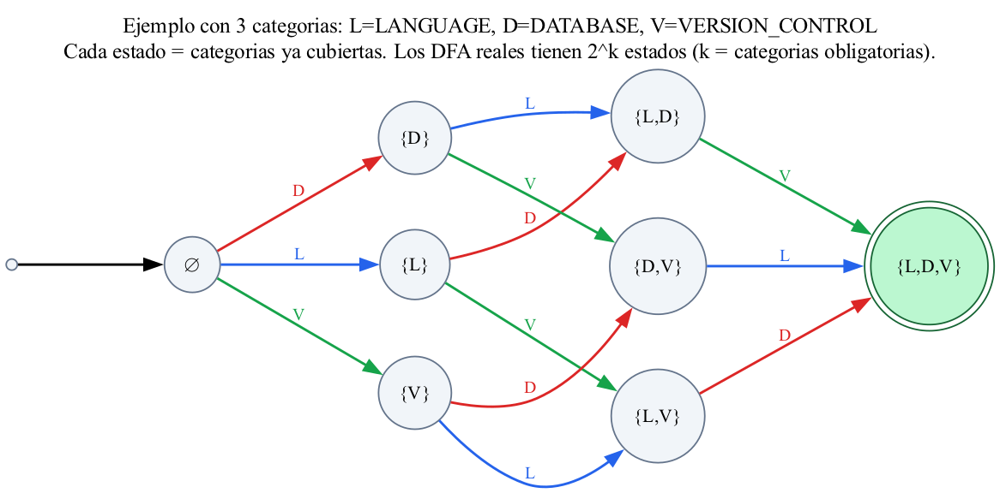
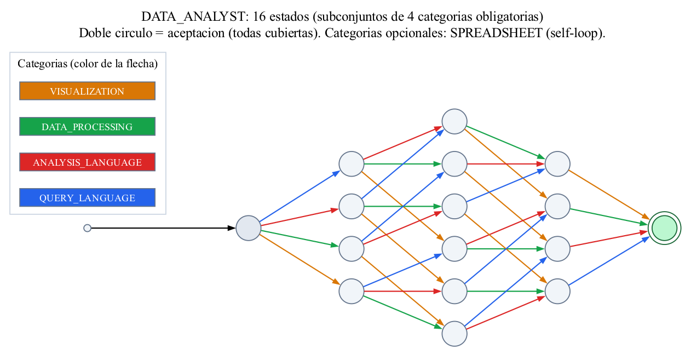
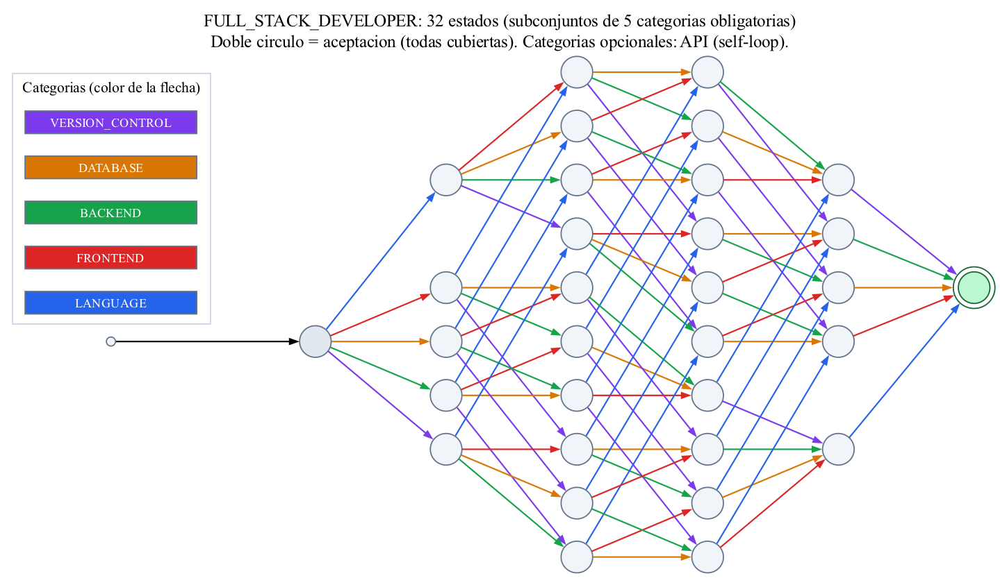

# Etapa 3: reconocimiento de patrones con autómatas finitos

Esta etapa recibe la lista de skills **canónicas** que produce el transductor de la etapa 2
(por ejemplo `PYTHON, PANDAS, TENSORFLOW, SQL, GIT`) y decide, para cada uno de los cuatro
perfiles, si cumple el patrón formal del perfil: `ACCEPTED` o `REJECTED`.

Los cuatro perfiles se procesan con **la misma solución general**
(`src/classification/profile_dfa.py`, función `build_profile_dfa`). Cada perfil solo cambia los
datos que le entrega: sus categorías y cuáles de ellas son opcionales. Los archivos
`full_stack_developer.py`, `machine_learning_engineer.py`, `qa_engineer.py` y `data_analyst.py`
construyen su autómata con esa misma lógica.

## 1. Idea del patrón

Un perfil es una lista de **categorías** (por ejemplo `LANGUAGE`, `FRONTEND`, `BACKEND`...) y cada
categoría tiene varias skills alternativas (`FRONTEND = {REACT, ANGULAR, VUE}`). Un candidato
cumple el perfil si tiene **al menos una skill de cada categoría obligatoria**. Las categorías
opcionales se aceptan, pero no son necesarias.

El orden en que el candidato escribió las skills no importa. Por eso el estado del autómata no
guarda *en qué posición va*, sino **qué categorías obligatorias ya se cubrieron**.

## 2. Definición formal

Para un perfil con categorías obligatorias `C = {c1, ..., ck}` y categorías opcionales `O`,
el autómata es **M = (Q, Σ, δ, q0, F)** con:

| Componente | Definición |
|---|---|
| **Q** | `P(C)`: todos los subconjuntos de categorías obligatorias ya cubiertas. Hay `2^k` estados. |
| **Σ** | Todos los tokens canónicos del perfil (los de categorías obligatorias y opcionales). |
| **q0** | `∅` (estado `q_empty`): ninguna categoría cubierta. |
| **F** | `{C}` (estado `q_all`): todas las categorías obligatorias cubiertas. |
| **δ** | Para un estado `S ⊆ C` y un token `t ∈ Σ` con categoría `cat(t)`: |
| | `δ(S, t) = S ∪ {cat(t)}` si `cat(t)` es obligatoria |
| | `δ(S, t) = S` si `cat(t)` es opcional (bucle sobre el mismo estado) |
| | `δ(S, t)` **indefinida** si `t ∉ Σ` (rechazo inmediato) |

Una secuencia `w = t1 t2 ... tn` se acepta si `δ*(q0, w) ∈ F`. La secuencia vacía se rechaza
explícitamente en el código, aunque ninguno de los estados finales es `q0` en estos perfiles.

## 3. Tipo de autómata: DFA (parcial)

Es un **autómata finito determinista** porque, según la definición anterior:

1. `δ` es una **función**, no una relación: para cada par (estado, símbolo) existe **a lo sumo
   una** transición. Dos tokens de una misma categoría llevan al mismo estado destino, y un
   mismo token nunca lleva a dos estados.
2. **No hay transiciones ε**: cada transición consume exactamente un símbolo.
3. Hay un único estado inicial.

Es **parcial** porque para los tokens ajenos al perfil no hay transición definida, y el
autómata rechaza en cuanto los lee (en `pyformlang`, la palabra no es aceptada). Se comprobó con
`dfa.is_deterministic()` en los cuatro perfiles.

Además se verificó con `dfa.minimize()` que ningún autómata se reduce: los `2^k` estados son
distinguibles entre sí, así que cada uno es necesario.

Se descartó un NFA o un ε-NFA porque el patrón no necesita elegir entre caminos ni saltos
vacíos: la categoría de cada token determina de forma única el siguiente estado.

## 4. Los cuatro autómatas

| Perfil | Categorías obligatorias (k) | Categoría opcional | \|Q\| = 2^k | \|Σ\| | \|δ\| |
|---|---|---|---|---|---|
| `FULL_STACK_DEVELOPER` | `LANGUAGE`, `FRONTEND`, `BACKEND`, `DATABASE`, `VERSION_CONTROL` (5) | `API` | 32 | 14 | 448 |
| `MACHINE_LEARNING_ENGINEER` | `LANGUAGE`, `DATA_PROCESSING`, `ML_LIBRARY`, `MODEL_FRAMEWORK`, `DATABASE`, `VERSION_CONTROL` (6) | ninguna | 64 | 10 | 640 |
| `QA_ENGINEER` | `TESTING`, `TEST_AUTOMATION`, `API_TESTING`, `PROGRAMMING`, `ISSUE_TRACKING`, `VERSION_CONTROL` (6) | ninguna | 64 | 13 | 832 |
| `DATA_ANALYST` | `QUERY_LANGUAGE`, `ANALYSIS_LANGUAGE`, `DATA_PROCESSING`, `VISUALIZATION` (4) | `SPREADSHEET` | 16 | 11 | 176 |

En los cuatro, `q0 = q_empty` y `F = {q_all}`.

### 4.1 Full Stack Developer

| Categoría | Skills (alfabeto Σ) |
|---|---|
| `LANGUAGE` | `JAVASCRIPT`, `TYPESCRIPT` |
| `FRONTEND` | `REACT`, `ANGULAR`, `VUE` |
| `BACKEND` | `NODE_JS`, `DJANGO`, `SPRING_BOOT` |
| `DATABASE` | `SQL`, `POSTGRESQL`, `MYSQL`, `MONGODB` |
| `API` (opcional) | `REST_API` |
| `VERSION_CONTROL` | `GIT` |

**Patrón:** lenguaje de programación web, un framework de frontend, uno de backend, una base de
datos y control de versiones. `REST_API` se acepta pero no se exige, porque el ejemplo de
Wednesday Addams del enunciado no la menciona y debe quedar aceptado.

### 4.2 Machine Learning Engineer

| Categoría | Skills (alfabeto Σ) |
|---|---|
| `LANGUAGE` | `PYTHON` |
| `DATA_PROCESSING` | `PANDAS`, `NUMPY` |
| `ML_LIBRARY` | `SCIKIT_LEARN` |
| `MODEL_FRAMEWORK` | `TENSORFLOW`, `PYTORCH` |
| `DATABASE` | `SQL`, `POSTGRESQL`, `MYSQL` |
| `VERSION_CONTROL` | `GIT` |

**Patrón:** Python, procesamiento de datos, una librería de aprendizaje automático clásico, un
framework de modelos, base de datos y control de versiones. Es el perfil del ejemplo del
enunciado: `PYTHON, PANDAS, TENSORFLOW, POSTGRESQL, GIT` (con `SCIKIT_LEARN` para cubrir la
categoría `ML_LIBRARY`).

### 4.3 QA Engineer (perfil propio de ingeniería de software)

| Categoría | Skills (alfabeto Σ) |
|---|---|
| `TESTING` | `PYTEST`, `JUNIT`, `TESTNG` |
| `TEST_AUTOMATION` | `SELENIUM`, `CYPRESS`, `PLAYWRIGHT` |
| `API_TESTING` | `POSTMAN`, `REST_ASSURED` |
| `PROGRAMMING` | `PYTHON`, `JAVA`, `JAVASCRIPT` |
| `ISSUE_TRACKING` | `JIRA` |
| `VERSION_CONTROL` | `GIT` |

**Patrón:** un framework de pruebas, una herramienta de automatización, una de pruebas de API,
un lenguaje de programación, un gestor de defectos y control de versiones.

### 4.4 Data Analyst (perfil propio de IA y datos)

| Categoría | Skills (alfabeto Σ) |
|---|---|
| `QUERY_LANGUAGE` | `SQL`, `POSTGRESQL`, `MYSQL` |
| `SPREADSHEET` (opcional) | `EXCEL` |
| `ANALYSIS_LANGUAGE` | `PYTHON`, `R` |
| `DATA_PROCESSING` | `PANDAS`, `NUMPY` |
| `VISUALIZATION` | `POWER_BI`, `TABLEAU`, `MATPLOTLIB` |

**Patrón:** un lenguaje de consulta, un lenguaje de análisis, procesamiento de datos y una
herramienta de visualización. La hoja de cálculo se acepta pero no se exige.

## 5. Diagramas de transición

El autómata real tiene una transición por cada skill (hasta 832 en QA Engineer), así que un
diagrama estado por estado es ilegible. Se usan dos vistas:

**Vista por categoría.** Cada estado es un subconjunto de las categorías obligatorias y cada flecha
es una *categoría* (todas las skills de esa categoría hacen la misma transición). Se omiten los
bucles (categoría ya cubierta, categoría opcional, skill repetida). Los diagramas se generan con:

```bash
python -m scripts.export_category_diagrams
```

Primero un ejemplo con 3 categorías (`LANGUAGE`, `DATABASE`, `VERSION_CONTROL`), donde cada estado
muestra qué categorías ya se cubrieron. Los autómatas reales siguen exactamente el mismo esquema
con `k` categorías y `2^k` estados.



Data Analyst (4 categorías obligatorias, 16 estados). El color de cada flecha indica la categoría:



Full Stack Developer (5 categorías obligatorias, 32 estados):



Los diagramas de Machine Learning Engineer y QA Engineer (64 estados cada uno) están en
`docs/diagrams/dfa_machine_learning_engineer_categories.png` y
`docs/diagrams/dfa_qa_engineer_categories.png`; son legibles solo en pantalla completa.

**Vista completa.** Los archivos `docs/diagrams/dfa_*.dot` (generados con
`python -m src.classification.visualize`) contienen el autómata con todas sus transiciones. Sirven
para inspección con Graphviz, no para leerse en una página. Para el autómata de Data Analyst, la
tabla de transiciones y un diagrama completo en Mermaid están en [`data-analyst.md`](data-analyst.md).

## 6. Ejemplos

Se asume que la etapa 2 ya normalizó y descartó las skills ajenas al perfil.

| Entrada (canónica) | Perfil | Resultado | Por qué |
|---|---|---|---|
| `JAVASCRIPT, REACT, NODE_JS, POSTGRESQL, GIT` | Full Stack | **ACCEPTED** | Cubre las 5 categorías obligatorias; `API` es opcional |
| `GIT, POSTGRESQL, JAVASCRIPT, NODE_JS, REACT` | Full Stack | **ACCEPTED** | El mismo conjunto en otro orden |
| `PYTHON, PANDAS, NUMPY, SCIKIT_LEARN, TENSORFLOW, SQL, GIT` | ML Engineer | **ACCEPTED** | Dos skills de `DATA_PROCESSING` se aceptan (bucle) |
| `PYTHON, PANDAS, SCIKIT_LEARN, TENSORFLOW, GIT` | ML Engineer | **REJECTED** | Falta `DATABASE` |
| `SQL, EXCEL, PYTHON, PANDAS, POWER_BI` | Data Analyst | **ACCEPTED** | Excel opcional presente |
| `SQL, PYTHON, PANDAS` | Data Analyst | **REJECTED** | Falta `VISUALIZATION` |
| `PYTEST, SELENIUM, POSTMAN, PYTHON, JIRA, GIT` | QA Engineer | **ACCEPTED** | Cubre las 6 categorías |
| `SQL, PYTHON, PANDAS, POWER_BI, COBOL` | Data Analyst | **REJECTED** | `COBOL ∉ Σ`: no hay transición |
| (secuencia vacía) | cualquiera | **REJECTED** | No cubre ninguna categoría |

## 7. Decisiones de diseño

- **Estado = subconjunto de categorías cubiertas.** Es lo que permite aceptar cualquier orden
  con un autómata de tamaño `2^k`, en vez de depender de un orden rígido.
- **Una sola construcción para los cuatro perfiles.** Agregar un perfil es agregar sus datos.
- **Los tokens ajenos al perfil rechazan en el autómata**, pero el sorter de la etapa 2
  (`sort_for_profile`) los elimina antes. Así, un `GIT` de más en el CV de un Data Analyst no lo
  rechaza: el candidato se evalúa solo por las skills que pertenecen al perfil.
- **Un candidato puede cumplir varios perfiles** a la vez. Cada perfil se evalúa por separado.
- **Categorías opcionales con bucle**, en vez de una transición ε, porque mantienen el autómata
  determinista.

## 8. Limitaciones

- El número de estados crece como `2^k` con las categorías obligatorias (64 en los perfiles de 6).
  Es aceptable para este tamaño, pero no escalaría a decenas de categorías sin otra
  representación (por ejemplo, un contador por categoría).
- El patrón solo exige **presencia**: no pondera años de experiencia ni nivel de dominio.
- Si el CV no menciona explícitamente una skill, no existe para el autómata.

## 9. Implementación y pruebas

- Código: `src/classification/profile_dfa.py` (construcción general con
  `pyformlang.finite_automaton.DeterministicFiniteAutomaton`), los cuatro archivos de perfil y
  `classifier.py` (`classify_candidate`).
- Pruebas: `tests/classification/test_profile_dfa.py` (objeto formal, aceptación, rechazo, orden,
  equivalencia con el DFA original de Data Analyst), `test_classifier.py` (los cuatro perfiles
  conectados con el transductor) y `test_data_analyst.py`.
