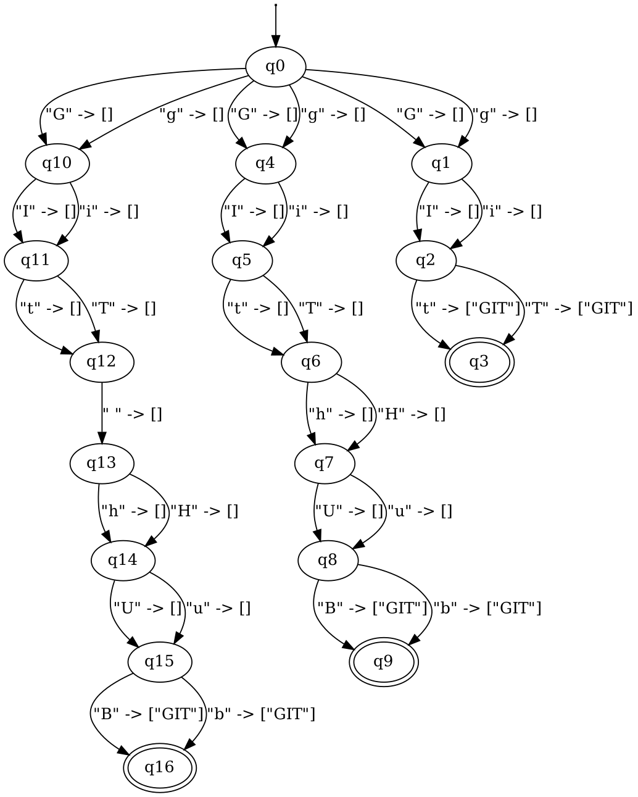
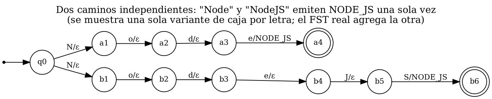

# ResumeLens — Etapa 2: Diseño y Formalización de Transductores de Estados Finitos (FST)

Este documento contiene la especificación formal y el diseño del módulo de normalización de cualificaciones de **ResumeLens**, correspondiente a la Etapa 2 del pipeline general.

---

## 1. Propósito de la Etapa de Normalización

En los currículums vítae reales, una misma habilidad técnica o cualificación suele expresarse mediante múltiples representaciones textuales equivalentes: variaciones de mayúsculas/minúsculas (`js`, `JS`, `JavaScript`), abreviaturas (`TS`, `Postgres`, `sklearn`), puntuaciones o sufijos tecnológicos (`Node.js`, `ReactJS`, `Cypress.io`) y espaciados alternativos (`Spring Boot`, `SpringBoot`, `Tensor Flow`).

Para que las etapas posteriores (ordenamiento canónico y reconocimiento mediante autómatas finitos en la Etapa 3) puedan operar de forma determinista y consistente, es indispensable traducir cualquier representación superficial válida a un **token canónico estándar**.

```text
Texto Crudo (Resume) ──[ Regex ]──> Tokens Extraídos ──[ FST ]──> Tokens Canónicos ──[ Sorter ]──> Secuencia Canónica
```

### 1.1 Delimitación Teórica: ¿Por qué Transductores (FST)?

En la teoría de lenguajes formales y autómatas:
- Las **expresiones regulares y los autómatas finitos (DFA/NFA)** operan como reconocedores de lenguajes: deciden si una cadena pertenece o no a un lenguaje regular ($L \subseteq \Sigma^*$).
- Los **transductores de estados finitos (FST - Finite-State Transducers)** modelan **relaciones racionales** entre dos alfabetos: realizan una traducción formal de secuencias, transformando una cadena de entrada sobre un alfabeto $\Sigma$ en una cadena de salida sobre un alfabeto $\Gamma$:
  $$T: \Sigma^* \to \Gamma^*$$

En ResumeLens, la normalización se modela explícitamente mediante transductores de estados finitos implementados con la biblioteca `pyformlang.fst.FST`. **No se utilizan atajos basados en diccionarios de traducción directa**. La transformación opera carácter por carácter a través de las transiciones del autómata transductor.

---

## 2. Arquitectura de Transducción en ResumeLens

### 2.1 Modelo Multitransductor por Familias Tecnológicas

En lugar de construir un único FST monolítico que contenga todas las habilidades del sistema, la arquitectura implementada en `src/normalization/transducers.py` instancia **9 transductores modulares**, uno por cada familia tecnológica declarada en `data/aliases.json`:

1. `LANGUAGES`
2. `FRONTEND`
3. `BACKEND`
4. `DATABASES`
5. `API`
6. `DATA_SCIENCE`
7. `ANALYTICS_TOOLS`
8. `QA_TOOLS`
9. `VERSION_CONTROL`

Esta partición presenta ventajas teóricas y prácticas:
- **Modularidad:** Permite actualizar, ampliar o depurar el vocabulario de una categoría (por ejemplo, agregar herramientas de QA) sin reconstruir ni comprometer los transductores de otras familias.
- **Prevención de colisiones:** Aísla el espacio de estados y evita ambigüedades cruzadas entre tecnologías.
- **Rendimiento:** Cada FST mantiene un tamaño acotado (entre 17 y 187 estados), facilitando su visualización y análisis formal.

### 2.2 Topología de Caminos Independientes

Un diseño común al construir autómatas para conjuntos de palabras es fusionar prefijos comunes formando un *trie*. Sin embargo, en un transductor que emite salidas completas, compartir prefijos genera problemas críticos cuando un alias es prefijo de otro. Por ejemplo, en la familia `BACKEND`, tanto `Node` como `NodeJS` son variantes válidas que deben emitir `NODE_JS`. Si compartieran estados:

$$\text{q0} \xrightarrow{\text{N}/\varepsilon} \text{q1} \xrightarrow{\text{o}/\varepsilon} \text{q2} \xrightarrow{\text{d}/\varepsilon} \text{q3} \xrightarrow{\text{e}/\text{NODE\_JS}} \text{q4} \dots$$

La palabra `"NodeJS"` pasaría por el estado `q4` (emitiendo `NODE_JS`) y continuaría hasta el final emitiendo nuevamente `NODE_JS`, produciendo una salida duplicada no deseada.

Para evitar esto, `src/normalization/transducers.py` implementa **caminos independientes de estados**:
- Cada alias genera una rama dedicada que parte exclusivamente desde el estado inicial `q0`.
- El transductor resultante es no determinista en sus transiciones iniciales desde `q0`, pero garantiza que una palabra solo se acepta si recorre **su camino completo** hasta su estado de aceptación específico.

### 2.3 Mecanismo de Traducción Carácter a Carácter

Cada FST consume la cadena de entrada un símbolo a la vez:
- **Transiciones intermedias:** Al leer los caracteres iniciales e intermedios del alias, la salida emitida es la cadena vacía $\varepsilon$ (`[]`).
- **Transición final:** Al leer el último carácter del alias y alcanzar el estado de aceptación $F$, el transductor emite una lista con el token canónico (`[CANONICAL_TOKEN]`).

#### Ejemplo de Transducción: `React.js` $\to$ `REACT`

Para el alias `React.js` correspondiente a la habilidad canónica `REACT`:

$$\begin{aligned}
q_0 &\xrightarrow{\text{'R'} \,/\, \varepsilon} q_1 \\
q_1 &\xrightarrow{\text{'e'} \,/\, \varepsilon} q_2 \\
q_2 &\xrightarrow{\text{'a'} \,/\, \varepsilon} q_3 \\
q_3 &\xrightarrow{\text{'c'} \,/\, \varepsilon} q_4 \\
q_4 &\xrightarrow{\text{'t'} \,/\, \varepsilon} q_5 \\
q_5 &\xrightarrow{\text{'.'} \,/\, \varepsilon} q_6 \\
q_6 &\xrightarrow{\text{'j'} \,/\, \varepsilon} q_7 \\
q_7 &\xrightarrow{\text{'s'} \,/\, \text{REACT}} q_8 \in F
\end{aligned}$$

Al ingresar la lista de caracteres `['R', 'e', 'a', 'c', 't', '.', 'j', 's']`, la llamada a `fst.translate(word)` produce la salida `[['REACT']]`.

### 2.4 Resolución de Mayúsculas y Minúsculas Embebida

La insensibilidad a mayúsculas/minúsculas no se resuelve mediante una conversión artificial externa (`.lower()`) que oculte la lógica del autómata. El FST resuelve la variación directamente en su función de transición $\delta$:
- Por cada carácter $c$ del alias, el constructor agrega dos transiciones hacia el siguiente estado: una para `c.lower()` y otra para `c.upper()` (o una sola si el carácter no tiene variación de caja, como números, puntos o espacios):

$$\delta(q_i, \text{'r'}) = (q_{i+1}, \varepsilon) \quad \text{y} \quad \delta(q_i, \text{'R'}) = (q_{i+1}, \varepsilon)$$

Esto permite que cadenas con variaciones arbitrarias de mayúsculas (por ejemplo `react`, `React`, `REACT`, `ReAcT`) sean aceptadas y traducidas por las mismas ramas del transductor.

### 2.5 Idempotencia y Auto-Reconocimiento Canónico

Para que el proceso de normalización sea formalmente idempotente:
$$\text{normalize}(\text{normalize}(x)) = \text{normalize}(x)$$

El constructor incluye cada token canónico dentro de su propia lista de alias:
`[canonical, *variants]`

De este modo:
- `normalize_skill("JS")` $\to$ `"JAVASCRIPT"`
- `normalize_skill("JAVASCRIPT")` $\to$ `"JAVASCRIPT"`

---

## 3. Preprocesamiento Textual: El Rol de `clean_token()`

En los currículums reales, las tecnologías vienen acompañadas de ruido tipográfico y signos de puntuación derivados de viñetas, listas o separadores de oraciones (por ejemplo: `• Git.`, `(Python)`, `- React.js`, `Node   JS`).

El alfabeto de entrada $\Sigma$ de los FSTs está compuesto estrictamente por los caracteres constitutivos de los alias válidos. La función `clean_token()` en `src/normalization/normalizer.py` actúa como una etapa previa de saneamiento léxico antes de ingresar la secuencia al FST:

1. **Normalización Unicode NFKC:** Convierte caracteres tipográficos exóticos y espacios no estándar en sus equivalentes canónicos ASCII.
2. **Homogeneización de guiones:** Transforma guiones tipográficos (`\u2010`, `\u2011`, `\u2013`) en guiones estándar `-`.
3. **Colapso de espacios múltiples:** Sustituye secuencias de dos o más espacios en blanco por un único espacio (`\s+` $\to$ `" "`).
4. **Remoción de ruido periférico:**
   - Elimina viñetas, asteriscos, guiones, paréntesis y comillas iniciales: `^[\s\-*•·()\[\]\"']+`.
   - Elimina puntuación terminal generada al final de una línea o párrafo: `[\s.,;:!?()\[\]\"']+$` (por ejemplo, el punto final de `"Git."` pasa a `"Git"`).
5. **Preservación de puntuación interna:** Conserva los puntos internos que forman parte integral de la tecnología (como en `Node.js` o `Cypress.io`) y los guiones internos (como en `Scikit-learn` o `Spring-Boot`).

`clean_token()` **no toma decisiones de equivalencia ni traduce nombres**. Solo entrega una palabra limpia lista para ser consumida carácter a carácter por el transductor.

---

## 4. Especificación Formal de los 9 Transductores FST

Cada transductor $M$ se define formalmente como una 7-tupla:

$$M = (Q, \Sigma, \Gamma, \delta, \omega, q_0, F)$$

Donde:
- **$Q$:** Conjunto finito de estados $\{q_0, q_1, \dots, q_N\}$.
- **$\Sigma$:** Alfabeto finito de entrada (caracteres individuales que componen los alias y tokens canónicos).
- **$\Gamma$:** Alfabeto finito de salida (conjunto de tokens canónicos producidos junto con el símbolo vacío $\varepsilon$).
- **$\delta \subseteq Q \times \Sigma \to \mathcal{P}(Q)$:** Relación de transición que asigna un estado origen y un carácter de entrada a los posibles estados siguientes.
- **$\omega \subseteq Q \times \Sigma \to \Gamma^*$:** Función/relación de salida que determina la cadena emitida en cada transición.
- **$q_0 \in Q$:** Estado inicial del transductor (`"q0"`).
- **$F \subseteq Q$:** Conjunto de estados finales o de aceptación.

A continuación se detalla la formalización de cada uno de los 9 transductores implementados en el sistema:

---

### 4.1 FST 1: `LANGUAGES`

- **Propósito:** Normaliza lenguajes de programación fundamentales utilizados en desarrollo web, análisis de datos y backend.
- **Habilidades Canónicas ($\Gamma$):** `JAVA`, `JAVASCRIPT`, `PYTHON`, `R`, `TYPESCRIPT`.

#### Ejemplos de Mapeo
| Entrada de Entrada ($\Sigma^*$) | Salida Canónica ($\Gamma^*$) |
| :--- | :--- |
| `"JS"`, `"Javascript"`, `"Java Script"`, `"ECMAScript"`, `"JAVASCRIPT"` | `JAVASCRIPT` |
| `"TS"`, `"Typescript"`, `"Type Script"`, `"TYPESCRIPT"` | `TYPESCRIPT` |
| `"Python"`, `"Python3"`, `"Python 3"`, `"Py"`, `"PYTHON"` | `PYTHON` |
| `"Java"`, `"JAVA"` | `JAVA` |
| `"R"`, `"R Language"` | `R` |

#### Definición de la 7-Tupla
- **$|Q| = 95$ estados:** $\{q_0, q_1, \dots, q_{94}\}$.
- **$|\Sigma| = 38$ símbolos de entrada:**  
  `{' ', '3', 'A', 'C', 'E', 'G', 'H', 'I', 'J', 'L', 'M', 'N', 'O', 'P', 'R', 'S', 'T', 'U', 'V', 'Y', 'a', 'c', 'e', 'g', 'h', 'i', 'j', 'l', 'm', 'n', 'o', 'p', 'r', 's', 't', 'u', 'v', 'y'}`
- **$\Gamma = \{\varepsilon, \text{JAVA}, \text{JAVASCRIPT}, \text{PYTHON}, \text{R}, \text{TYPESCRIPT}\}$**
- **$q_0 = \text{"q0"}$**
- **$|F| = 14$ estados finales:** Correspondientes al término de los 14 alias únicos del vocabulario.
- **Transiciones:** 182 transiciones directas.
  - Para caracteres intermedios: $\omega(q, c) = \varepsilon$.
  - Para el último carácter de un alias: $\omega(q, c) = \text{CANONICAL}$.

---

### 4.2 FST 2: `FRONTEND`

- **Propósito:** Normaliza librerías y frameworks modernos de interfaz de usuario.
- **Habilidades Canónicas ($\Gamma$):** `ANGULAR`, `REACT`, `VUE`.

#### Ejemplos de Mapeo
| Entrada de Entrada ($\Sigma^*$) | Salida Canónica ($\Gamma^*$) |
| :--- | :--- |
| `"React"`, `"React.js"`, `"ReactJS"`, `"React JS"`, `"REACT"` | `REACT` |
| `"Angular"`, `"AngularJS"`, `"Angular.js"`, `"Angular JS"`, `"ANGULAR"` | `ANGULAR` |
| `"Vue"`, `"Vue.js"`, `"VueJS"`, `"Vue JS"`, `"VUE"` | `VUE` |

#### Definición de la 7-Tupla
- **$|Q| = 85$ estados:** $\{q_0, q_1, \dots, q_{84}\}$.
- **$|\Sigma| = 26$ símbolos de entrada:**  
  `{' ', '.', 'A', 'C', 'E', 'G', 'J', 'L', 'N', 'R', 'S', 'T', 'U', 'V', 'a', 'c', 'e', 'g', 'j', 'l', 'n', 'r', 's', 't', 'u', 'v'}`
- **$\Gamma = \{\varepsilon, \text{ANGULAR}, \text{REACT}, \text{VUE}\}$**
- **$q_0 = \text{"q0"}$**
- **$|F| = 12$ estados finales.**
- **Transiciones:** 162 transiciones.

---

### 4.3 FST 3: `BACKEND`

- **Propósito:** Normaliza entornos de ejecución y frameworks de desarrollo del lado del servidor.
- **Habilidades Canónicas ($\Gamma$):** `DJANGO`, `NODE_JS`, `SPRING_BOOT`.

#### Ejemplos de Mapeo
| Entrada de Entrada ($\Sigma^*$) | Salida Canónica ($\Gamma^*$) |
| :--- | :--- |
| `"Node"`, `"NodeJS"`, `"Node.js"`, `"Node JS"`, `"NODE_JS"` | `NODE_JS` |
| `"Django"`, `"DJANGO"` | `DJANGO` |
| `"Spring Boot"`, `"SpringBoot"`, `"Spring-Boot"`, `"Spring"`, `"SPRING_BOOT"` | `SPRING_BOOT` |

#### Definición de la 7-Tupla
- **$|Q| = 87$ estados:** $\{q_0, q_1, \dots, q_{86}\}$.
- **$|\Sigma| = 30$ símbolos de entrada:**  
  `{' ', '-', '.', 'A', 'B', 'D', 'E', 'G', 'I', 'J', 'N', 'O', 'P', 'R', 'S', 'T', '_', 'a', 'b', 'd', 'e', 'g', 'i', 'j', 'n', 'o', 'p', 'r', 's', 't'}`
- **$\Gamma = \{\varepsilon, \text{DJANGO}, \text{NODE\_JS}, \text{SPRING\_BOOT}\}$**
- **$q_0 = \text{"q0"}$**
- **$|F| = 11$ estados finales.**
- **Transiciones:** 166 transiciones.

---

### 4.4 FST 4: `DATABASES`

- **Propósito:** Normaliza motores de bases de datos relacionales, no relacionales y lenguajes de consulta estándar.
- **Habilidades Canónicas ($\Gamma$):** `MONGODB`, `MYSQL`, `POSTGRESQL`, `SQL`.

#### Ejemplos de Mapeo
| Entrada de Entrada ($\Sigma^*$) | Salida Canónica ($\Gamma^*$) |
| :--- | :--- |
| `"Postgres"`, `"PostgreSQL"`, `"Postgre SQL"`, `"POSTGRESQL"` | `POSTGRESQL` |
| `"MySQL"`, `"My SQL"`, `"MYSQL"` | `MYSQL` |
| `"MongoDB"`, `"Mongo"`, `"Mongo DB"`, `"MONGODB"` | `MONGODB` |
| `"SQL"` | `SQL` |

#### Definición de la 7-Tupla
- **$|Q| = 64$ estados:** $\{q_0, q_1, \dots, q_{63}\}$.
- **$|\Sigma| = 29$ símbolos de entrada:**  
  `{' ', 'B', 'D', 'E', 'G', 'L', 'M', 'N', 'O', 'P', 'Q', 'R', 'S', 'T', 'Y', 'b', 'd', 'e', 'g', 'l', 'm', 'n', 'o', 'p', 'q', 'r', 's', 't', 'y'}`
- **$\Gamma = \{\varepsilon, \text{MONGODB}, \text{MYSQL}, \text{POSTGRESQL}, \text{SQL}\}$**
- **$q_0 = \text{"q0"}$**
- **$|F| = 9$ estados finales.**
- **Transiciones:** 123 transiciones.

---

### 4.5 FST 5: `API`

- **Propósito:** Normaliza patrones arquitectónicos de interfaces de programación de aplicaciones orientadas a servicios web.
- **Habilidades Canónicas ($\Gamma$):** `REST_API`.

#### Ejemplos de Mapeo
| Entrada de Entrada ($\Sigma^*$) | Salida Canónica ($\Gamma^*$) |
| :--- | :--- |
| `"REST"`, `"REST API"`, `"REST APIs"`, `"RESTful"`, `"RESTful API"`, `"RESTful APIs"`, `"REST_API"` | `REST_API` |

#### Definición de la 7-Tupla
- **$|Q| = 60$ estados:** $\{q_0, q_1, \dots, q_{59}\}$.
- **$|\Sigma| = 22$ símbolos de entrada:**  
  `{' ', 'A', 'E', 'F', 'I', 'L', 'P', 'R', 'S', 'T', 'U', '_', 'a', 'e', 'f', 'i', 'l', 'p', 'r', 's', 't', 'u'}`
- **$\Gamma = \{\varepsilon, \text{REST\_API}\}$**
- **$q_0 = \text{"q0"}$**
- **$|F| = 7$ estados finales.**
- **Transiciones:** 113 transiciones.

---

### 4.6 FST 6: `DATA_SCIENCE`

- **Propósito:** Normaliza librerías y marcos de trabajo para procesamiento numérico, manipulación de datos, graficación y modelos de Deep Learning/Machine Learning.
- **Habilidades Canónicas ($\Gamma$):** `MATPLOTLIB`, `NUMPY`, `PANDAS`, `PYTORCH`, `SCIKIT_LEARN`, `TENSORFLOW`.

#### Ejemplos de Mapeo
| Entrada de Entrada ($\Sigma^*$) | Salida Canónica ($\Gamma^*$) |
| :--- | :--- |
| `"Pandas"`, `"PANDAS"` | `PANDAS` |
| `"NumPy"`, `"Num Py"`, `"NUMPY"` | `NUMPY` |
| `"sklearn"`, `"scikit learn"`, `"Scikit-learn"`, `"scikit_learn"`, `"SCIKIT_LEARN"` | `SCIKIT_LEARN` |
| `"TensorFlow"`, `"Tensor Flow"`, `"TF"`, `"TENSORFLOW"` | `TENSORFLOW` |
| `"PyTorch"`, `"Py Torch"`, `"Torch"`, `"PYTORCH"` | `PYTORCH` |
| `"Matplotlib"`, `"Mat Plot Lib"`, `"mpl"`, `"MATPLOTLIB"` | `MATPLOTLIB` |

#### Definición de la 7-Tupla
- **$|Q| = 129$ estados:** $\{q_0, q_1, \dots, q_{128}\}$.
- **$|\Sigma| = 43$ símbolos de entrada:**  
  `{' ', '-', 'A', 'B', 'C', 'D', 'E', 'F', 'H', 'I', 'K', 'L', 'M', 'N', 'O', 'P', 'R', 'S', 'T', 'U', 'W', 'Y', '_', 'a', 'b', 'c', 'd', 'e', 'f', 'h', 'i', 'k', 'l', 'm', 'n', 'o', 'p', 'r', 's', 't', 'u', 'w', 'y'}`
- **$\Gamma = \{\varepsilon, \text{MATPLOTLIB}, \text{NUMPY}, \text{PANDAS}, \text{PYTORCH}, \text{SCIKIT\_LEARN}, \text{TENSORFLOW}\}$**
- **$q_0 = \text{"q0"}$**
- **$|F| = 16$ estados finales.**
- **Transiciones:** 248 transiciones.

---

### 4.7 FST 7: `ANALYTICS_TOOLS`

- **Propósito:** Normaliza herramientas de analítica de negocio, hojas de cálculo y plataformas de visualización de inteligencia empresarial (BI).
- **Habilidades Canónicas ($\Gamma$):** `EXCEL`, `POWER_BI`, `TABLEAU`.

#### Ejemplos de Mapeo
| Entrada de Entrada ($\Sigma^*$) | Salida Canónica ($\Gamma^*$) |
| :--- | :--- |
| `"Excel"`, `"MS Excel"`, `"Microsoft Excel"`, `"EXCEL"` | `EXCEL` |
| `"Power BI"`, `"PowerBI"`, `"Power-BI"`, `"POWER_BI"` | `POWER_BI` |
| `"Tableau"`, `"TABLEAU"` | `TABLEAU` |

#### Definición de la 7-Tupla
- **$|Q| = 67$ estados:** $\{q_0, q_1, \dots, q_{66}\}$.
- **$|\Sigma| = 35$ símbolos de entrada:**  
  `{' ', '-', 'A', 'B', 'C', 'E', 'F', 'I', 'L', 'M', 'O', 'P', 'R', 'S', 'T', 'U', 'W', 'X', '_', 'a', 'b', 'c', 'e', 'f', 'i', 'l', 'm', 'o', 'p', 'r', 's', 't', 'u', 'w', 'x'}`
- **$\Gamma = \{\varepsilon, \text{EXCEL}, \text{POWER\_BI}, \text{TABLEAU}\}$**
- **$q_0 = \text{"q0"}$**
- **$|F| = 8$ estados finales.**
- **Transiciones:** 127 transiciones.

---

### 4.8 FST 8: `QA_TOOLS`

- **Propósito:** Normaliza herramientas para pruebas unitarias, automatización de pruebas web/móvil, pruebas de APIs y gestión de incidencias/seguimiento de proyectos.
- **Habilidades Canónicas ($\Gamma$):** `CYPRESS`, `JIRA`, `JUNIT`, `PLAYWRIGHT`, `POSTMAN`, `PYTEST`, `REST_ASSURED`, `SELENIUM`, `TESTNG`.

#### Ejemplos de Mapeo
| Entrada de Entrada ($\Sigma^*$) | Salida Canónica ($\Gamma^*$) |
| :--- | :--- |
| `"pytest"`, `"Py Test"`, `"PYTEST"` | `PYTEST` |
| `"JUnit"`, `"JUnit5"`, `"JUnit 5"`, `"J Unit"`, `"JUNIT"` | `JUNIT` |
| `"TestNG"`, `"Test NG"`, `"TESTNG"` | `TESTNG` |
| `"Selenium"`, `"Selenium WebDriver"`, `"SELENIUM"` | `SELENIUM` |
| `"Cypress"`, `"Cypress.io"`, `"CYPRESS"` | `CYPRESS` |
| `"Playwright"`, `"Play Wright"`, `"PLAYWRIGHT"` | `PLAYWRIGHT` |
| `"Postman"`, `"POSTMAN"` | `POSTMAN` |
| `"Rest Assured"`, `"RestAssured"`, `"REST-assured"`, `"REST_ASSURED"` | `REST_ASSURED` |
| `"Jira"`, `"Atlassian Jira"`, `"JIRA"` | `JIRA` |

#### Definición de la 7-Tupla
- **$|Q| = 187$ estados:** $\{q_0, q_1, \dots, q_{186}\}$.
- **$|\Sigma| = 47$ símbolos de entrada:**  
  `{' ', '-', '.', '5', 'A', 'B', 'C', 'D', 'E', 'G', 'H', 'I', 'J', 'L', 'M', 'N', 'O', 'P', 'R', 'S', 'T', 'U', 'V', 'W', 'Y', '_', 'a', 'b', 'c', 'd', 'e', 'g', 'h', 'i', 'j', 'l', 'm', 'n', 'o', 'p', 'r', 's', 't', 'u', 'v', 'w', 'y'}`
- **$\Gamma = \{\varepsilon, \text{CYPRESS}, \text{JIRA}, \text{JUNIT}, \text{PLAYWRIGHT}, \text{POSTMAN}, \text{PYTEST}, \text{REST\_ASSURED}, \text{SELENIUM}, \text{TESTNG}\}$**
- **$q_0 = \text{"q0"}$**
- **$|F| = 21$ estados finales.**
- **Transiciones:** 359 transiciones.

---

### 4.9 FST 9: `VERSION_CONTROL`

- **Propósito:** Normaliza sistemas de control de versiones y plataformas asociadas.
- **Habilidades Canónicas ($\Gamma$):** `GIT`.

#### Ejemplos de Mapeo
| Entrada de Entrada ($\Sigma^*$) | Salida Canónica ($\Gamma^*$) |
| :--- | :--- |
| `"Git"`, `"GitHub"`, `"Git Hub"`, `"GIT"` | `GIT` |

#### Definición de la 7-Tupla
- **$|Q| = 17$ estados:** $\{q_0, q_1, \dots, q_{16}\}$.
- **$|\Sigma| = 13$ símbolos de entrada:**  
  `{' ', 'B', 'G', 'H', 'I', 'T', 'U', 'b', 'g', 'h', 'i', 't', 'u'}`
- **$\Gamma = \{\varepsilon, \text{GIT}\}$**
- **$q_0 = \text{"q0"}$**
- **$|F| = 3$ estados finales.**
- **Transiciones:** 31 transiciones.

---

### 4.10 Diagramas

**Transductor completo de `VERSION_CONTROL`** (17 estados). Cada alias es una rama independiente
desde `q0`, con dos transiciones por letra (mayúscula y minúscula). La última letra emite `GIT`.



**Caminos independientes** para `Node` y `NodeJS` (familia `BACKEND`). Al no compartir prefijo, cada
palabra emite `NODE_JS` exactamente una vez.



Los `.dot` de las 9 familias están en `docs/diagrams/`.

---

## 5. Tabla Resumen Comparativa de los 9 FSTs

A continuación se consolidan los componentes cuantitativos y cualitativos exactos de los 9 transductores que integran el sistema:

| Familia Tecnológica | Nº Estados ($\lvert Q \rvert$) | Símbolos de Entrada ($\lvert \Sigma \rvert$) | Tokens de Salida (sin $\varepsilon$) | Nº Transiciones | Estados Finales ($\lvert F \rvert$) | Habilidades Canónicas Producidas |
| :--- | :---: | :---: | :---: | :---: | :---: | :--- |
| **`LANGUAGES`** | 95 | 38 | 5 | 182 | 14 | `JAVA`, `JAVASCRIPT`, `PYTHON`, `R`, `TYPESCRIPT` |
| **`FRONTEND`** | 85 | 26 | 3 | 162 | 12 | `ANGULAR`, `REACT`, `VUE` |
| **`BACKEND`** | 87 | 30 | 3 | 166 | 11 | `DJANGO`, `NODE_JS`, `SPRING_BOOT` |
| **`DATABASES`** | 64 | 29 | 4 | 123 | 9 | `MONGODB`, `MYSQL`, `POSTGRESQL`, `SQL` |
| **`API`** | 60 | 22 | 1 | 113 | 7 | `REST_API` |
| **`DATA_SCIENCE`** | 129 | 43 | 6 | 248 | 16 | `MATPLOTLIB`, `NUMPY`, `PANDAS`, `PYTORCH`, `SCIKIT_LEARN`, `TENSORFLOW` |
| **`ANALYTICS_TOOLS`** | 67 | 35 | 3 | 127 | 8 | `EXCEL`, `POWER_BI`, `TABLEAU` |
| **`QA_TOOLS`** | 187 | 47 | 9 | 359 | 21 | `CYPRESS`, `JIRA`, `JUNIT`, `PLAYWRIGHT`, `POSTMAN`, `PYTEST`, `REST_ASSURED`, `SELENIUM`, `TESTNG` |
| **`VERSION_CONTROL`**| 17 | 13 | 1 | 31 | 3 | `GIT` |
| **TOTALES DEL SISTEMA** | **791** | — | **35** (sin $\varepsilon$) | **1511** | **101** | **35 Habilidades Canónicas Globales** |

---

## 6. Integración en el Pipeline y Relación con el Sorter

### 6.1 Mecanismo de Consulta en `normalizer.py`

Cuando el módulo de extracción (Regex) entrega una lista de cadenas detectadas en el currículum, la función `normalize_qualifications()` coordina el proceso:

1. **`clean_token(raw)`:** Sanea la cadena eliminando viñetas o puntuación limítrofe y preservando puntos y guiones semánticos.
2. **`normalize_skill(raw)`:**
   - Convierte el token limpio en una lista de caracteres individuales `word = list(clean_token(raw))`.
   - Consulta secuencialmente los 9 transductores de `_FSTS`:
     ```python
     for fst in _FSTS.values():
         outputs = list(fst.translate(word))
         if outputs and outputs[0]:
             return str(outputs[0][0])
     return None
     ```
   - Si algún FST traduce con éxito la palabra, devuelve el token canónico asociado. Si ningún FST reconoce la secuencia, retorna `None`.
3. **`normalize()`:** Separa los tokens conocidos de los desconocidos y elimina duplicados preservando el orden de primera aparición.

### 6.2 Relación entre FST y el Ordenador Canónico (`sorter.py`)

Una vez que el FST produce el conjunto de habilidades canónicas normalizadas, estas se entregan al módulo de ordenamiento canónico (`src/normalization/sorter.py`):
- Los autómatas de perfil (DFA de la Etapa 3) evalúan secuencias según categorías formales estructuradas.
- Cada perfil en `src/classification/profiles.py` define un `canonical_order` (por ejemplo, `Full Stack` espera: `LANGUAGE` $\to$ `FRONTEND` $\to$ `BACKEND` $\to$ `DATABASE` $\to$ `API` $\to$ `VERSION_CONTROL`).
- La función `sort_for_profile(skills, profile)` asigna una tupla de prioridad `(indice_categoria, indice_opcion)` a cada habilidad canónica y descarta los tokens ajenos que no pertenezcan al perfil evaluado.

De esta forma, si el candidato escribió:
`["Git", "NodeJS", "JS", "Postgres", "React.js"]`

El proceso completo actúa en dos pasos:
1. **FST Normalizer:**
   `["GIT", "NODE_JS", "JAVASCRIPT", "POSTGRESQL", "REACT"]`
2. **Profile Sorter (para Full Stack):**
   `["JAVASCRIPT", "REACT", "NODE_JS", "POSTGRESQL", "GIT"]`

Esto desacopla por completo la evaluación de idoneidad del candidato del orden arbitrario en el que fueron redactadas sus cualificaciones en la hoja de vida.

---

## 7. Verificación y Cobertura de Pruebas

El diseño formal especificado en este documento está respaldado por **114 pruebas unitarias automatizadas** contenidas en el directorio `tests/normalization/`:

1. **`test_transducers.py` (10 pruebas formales):**
   - Comprueba la correspondencia exacta entre las familias de `aliases.json` y los FSTs instanciados.
   - Verifica los componentes de la 7-tupla formal ($Q, \Sigma, \Gamma, q_0, F$).
   - Garantiza que los estados finales y el estado inicial sean subconjuntos válidos de $Q$.
   - Verifica que el alfabeto de salida $\Gamma$ pertenezca estrictamente al vocabulario canónico autorizado.
   - Valida que el alfabeto de entrada $\Sigma$ esté constituido únicamente por caracteres de longitud 1.
   - Asegura la no duplicación de ramas por variaciones de caja.
   - Comprueba el lanzamiento de errores en caso de alias ambiguos.
   - Verifica que prefijos como `Node` y `NodeJS` emitan exactamente una salida en caminos independientes.

2. **`test_normalizer.py` (77 pruebas funcionales y de borde):**
   - Mapeo de todos los alias del enunciado y de las extensiones propuestas.
   - Insensibilidad estricta a mayúsculas/minúsculas.
   - Idempotencia para cada uno de los 35 tokens canónicos.
   - Rechazo riguroso (retorna `None`) ante tecnologías fuera de vocabulario (`Cobol`, `Photoshop`), casi-alias (`Reactt`, `Node.jss`), prefijos truncados (`Nod`, `React.j`), entradas pegadas (`React.js, Node`), caracteres especiales/emojis (`😀`, `Pythön`) y ruido sin contenido (`""`, `"..."`).
   - Pruebas de limpieza y preservación de puntos y guiones internos.

3. **`test_sorter.py` (27 pruebas de ordenamiento y filtrado):**
   - Casos dorados de ordenamiento canónico para los 4 perfiles profesionales.
   - Invariancia del resultado ante permutaciones aleatorias de entrada.
   - Descarte formal de tokens ajenos al perfil analizado.
